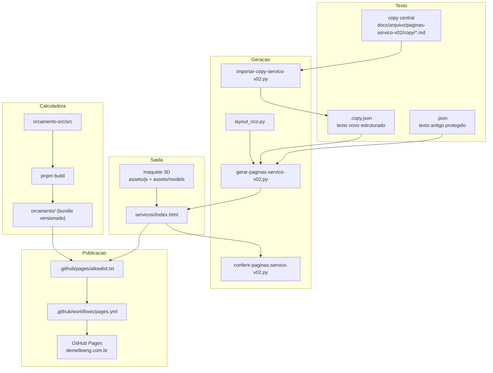

# Mapa do código: site da DEMELLO Engenharia

> **Candidata local PSCIP + GLP V02 — 05/11/2026, issue #12. Não publicada.** Base `main` conferida: `c6541bd`. Duas URLs mantidas e indexáveis, incêndio como página integrada e gás/GLP como página específica. Catálogo transitoriamente com oito cartões e nove URLs técnicas. Nenhuma alteração em preços, seleção, payload ou bundle da calculadora. Atualização dirigida dos módulos afetados; Cartographer não executado (não houve ordem para sua execução paralela geral).

### Frente PSCIP + GLP: fontes e reprodução

- `docs/arquivo/paginas-servico-v02/copy/COPY_PSCIP_GLP_V02_20261105.md` é a fonte editorial nova. O importador delega o perfil `pscip-glp` para `scripts/copy_pscip_glp.py::parse_copy`: rótulos fechados, quatro etapas, FAQ com vários parágrafos, notas editoriais ligadas à pergunta e excluídas do HTML, dois CTAs. Gera `projeto-prevencao-incendio.copy.json`. O bloco antigo de limites não é herdado.
- `projeto-gas-glp.json` continua sendo a fonte própria de GLP. `gas_copy()` a adapta ao perfil rico `gas-glp`, sem duplicar a copy de AVCB. Os deltas removem negativas de capacidade e ressalva de CNPJ (Voz V07), corrigem a referência à calculadora e acrescentam duas ligações contextuais à página integrada. Incêndio tem duas ligações contextuais para GLP, em bloco técnico/comercial e no fechamento.
- `scripts/layout_rico.py`: `hero_instalacoes()` prioriza chamada e CTA antes das introduções; `etapas_incendio()` renderiza Projeto → Aprovação → Obra → Vistoria; `frente_incendio()` e `frente_gas()` compõem os perfis; `prova_instalacoes()` preserva todos os parágrafos e não soma subescopos. Perfis anteriores mantidos.
- `scripts/gerar-paginas-servico-v02.py::gerar()` seleciona esses perfis e os recursos exclusivos. Os metadados mantêm URLs próprias; JSON-LD é atualizado estruturalmente apenas nesses perfis. Há dois serviços distintos na página integrada.
- Catálogo: `docs/arquivo/servicos-v01-20261028/conteudo.json` e `icones.json`, mais `header.template.html`, `footer.template.html` e `head.template.html`. `gerar-servicos-v02.py::row(item)` usa ID estável e grupo explícito, sem índices de serviço para B2B/agrupamento. O limite de Infraestrutura foi trazido do HTML aprovado para a fonte central, eliminando a reversão anterior. Menu com Construir ou ampliar e rodapé com Facebook são reproduzíveis.
- Estilos locais: `servico-pscip-glp-v02.css`, `catalogo-pscip-glp-v02.css`, `hidrantes-luiz-carlos-v02.css`. Nenhuma mudança nas folhas compartilhadas das oito páginas anteriores.
- Maquete aceita `b52e32d`: `assets/models/hidrantes-luiz-carlos-v02.glb` e `.json` copiados sem alteração, com token de versão comum. GLB 1.857.508 bytes, 171 identidades. `hidrantes-luiz-carlos-ativar.js` só importa o runtime após clique; `hidrantes-luiz-carlos-v02.js` e `hidrantes-luiz-carlos-core.mjs` preservam as interações, com proteção contra abertura assíncrona obsoleta após fechar. Pôster PNG capturado do visualizador aceito. Sem IFC, ZIP, conversores ou evidências na allowlist.
- `conferir-paginas-servico-v02.py`: verifica todos os blocos novos, SEO, microtexto e CTAs desses dois perfis; notas condicionais não podem vazar. A normalização de breadcrumb é simétrica para os perfis legados.
- Testes: `scripts/test_pscip_glp.py` (parser, rejeição de fontes inválidas, mutação da copy/CTA, reprodução de quatro perfis anteriores e determinismo); `orcamento-src/tests/pscip_glp.test.mjs` (URLs, links, CTAs, catálogo e hashes); `pscip_race.test.mjs` (fechamento concorrente). Suíte Node e contratos Python incluídos em `pages.yml`; isso não altera seu gatilho de publicação.
- Capturas/relatório de navegador: `docs/arquivo/pscip-glp-v02-20261105/`, fora do artefato público. Harnesses locais `scripts/pscip-glp.browser.cjs` e `pscip-glp-race.browser.cjs` aceitam somente localhost. Capturas em 1440×900 e 390×844; aparelho físico e aceite da página integrada continuam humanos.

Fluxo na raiz (não usar `extrair` nem `gerar --todas`):

```text
python -B scripts/importar-copy-servico-v02.py projeto-prevencao-incendio COPY_PSCIP_GLP_V02_20261105.md "Projeto de incêndio e gás/GLP"
python -B scripts/gerar-paginas-servico-v02.py gerar projeto-prevencao-incendio
python -B scripts/gerar-paginas-servico-v02.py gerar projeto-gas-glp
python -B scripts/gerar-servicos-v02.py
python -B scripts/conferir-paginas-servico-v02.py
python -B -m unittest discover -s scripts -p test_pscip_glp.py
npm --prefix orcamento-src test
npm --prefix orcamento-src run publish-guard
```

A segunda geração deve produzir os mesmos bytes. Gates locais de artefato mantêm a interface `build <commit> --out <pasta>`, `validate <commit> --artifact <pasta>`, `smoke-local --artifact <pasta>`. Nunca disparar `pages.yml` para validar esta candidata: o workflow publica.

> **Documento canônico do site (decisão de Marcos, 30/10/2026).** Fica no repositório, versionado junto com o código. **Toda mudança estrutural no site muda este mapa na mesma entrega:** página nova, serviço renomeado ou agrupado, script novo, teste novo, arquivo na allowlist, mudança de menu, de rodapé ou de publicação. A skill `gerar-pagina-servico` inclui esse passo. Para atualizar, rodar o Cartographer em modo de atualização (ele reaproveita o que não mudou).

> **Atualização dirigida em 02/11/2026, release parcial** (branch de trabalho `prep/release-parcial-20261102`): three.js hospedado, allowlist ampliada em 56 caminhos e testes do G1 atualizados para a Home V02 e as páginas V02 (seções de maquete, publicação, armadilhas e o guia de navegação). Conteúdo **não verificado de novo**: contagens de arquivo e de tokens do cabeçalho.
>
> **Atualização dirigida em 02/11/2026** (branch `claude/infraestrutura-v01-20261102`, página de Infraestrutura): seções 3, 4, 8 e 13 e o guia de navegação foram editados à mão; **o Cartographer não foi rodado**. As contagens de arquivo e de tokens do cabeçalho seguem as de 30/10.

> **Atualização dirigida em 03/11/2026** (branch `claude/rodape-home-servicos`): a Home e os Serviços passam a usar o mesmo rodapé rico das páginas de projeto, com o CSS compartilhado `assets/css/rodape-v02.css` (na allowlist). O teste `commercial_site` ganhou a checagem "rodapé: as seis páginas lançadas têm o mesmo rodapé". O item 8 da seção de armadilhas foi ajustado à mão; o Cartographer não foi rodado.
>
> **Atualização dirigida em 03/11/2026** (branch local `local/contato-v02`, página Contato V02, **ainda não publicada**): `contato/index.html` passa a ser **gerado** por `scripts/gerar-contato-v02.py` a partir da copy `docs/arquivo/contato-v02-20261103/COPY_CONTATO_V03_20261103.md` (a V02 fica como histórico), com o CSS isolado `assets/css/contato-v02.css` (na allowlist). Seção 3.6 nova; a linha do `contato/` na seção 2 e os testes `hotfix` e `commercial_site` foram ajustados. O Cartographer não foi rodado.
>
> **Atualização dirigida em 04/11/2026** (branch `claude/construir-menu-facebook-v02`, **ainda não publicada**; a nota anterior diz que a Contato não estava publicada, mas ela foi publicada em 03/11 pelo PR #43): (1) a página **Construir ou ampliar** passa ao visual V02, **gerada** por `scripts/gerar-construir-ou-ampliar-v02.py` (seção 3.7); (2) o menu das oito páginas V02 ganha o botão **Construir ou ampliar** (vazado) antes de "Calcular estimativa" (sólido), com o menu móvel mais cedo (até 1280px nas páginas de `servicos-v02.css` e até 1120px na Home) e o `min-width` do orçamento removido; (3) o rodapé das oito páginas V02 ganha **Facebook** entre Instagram e LinkedIn. Páginas antigas, `verificar` e `/orcamento/` não mudam. O Cartographer não foi rodado.
>
> Gerado pelo Cartographer em 2026-10-30T08:01:20Z, por seis leituras em paralelo (calculadora, testes, scripts e publicação, copy central, maquete 3D e páginas HTML).
> **Leitura estática:** nada foi executado (nem os testes, nem o build). Onde um relatório citou um número que não foi conferido, o texto diz.
> Estado do repositório no mapeamento: branch `claude/hidrossanitario-v01-20261029` (a nova versão do site, em paralelo; a `main` continua em `27a229e` e é o que está no ar). Dois arquivos sem rastreio no Git: `assets/models/hidro-redes.glb` e `.json`.

## 1. Visão geral

O repositório guarda **duas coisas** que se publicam juntas:

1. **O site estático** (HTML escrito à mão ou gerado por script), com CSS, JS de página e modelos 3D.
2. **A calculadora de estimativa** (`/orcamento/`), um app React 19 + Vite cujo fonte está em `orcamento-src/` e cujo resultado compilado fica em `orcamento/` (artefato versionado).

A publicação é por **GitHub Pages**: um push na `main` roda o workflow, que monta o artefato **só com os arquivos listados na allowlist**. Não existe etapa de aprovação.



**Regra central:** página de serviço nunca se edita à mão. O texto sai da copy; o HTML sai do gerador.

## 2. Estrutura de diretórios

```
site-hidro/
├── index.html                  Home (layout próprio, manual)
├── 404.html                    Página de erro (caminhos absolutos, noindex)
├── CNAME  robots.txt  sitemap.xml  google1483671950bc0cbc.html
├── .mcp.json                   Playwright MCP (ainda não testado)
├── .claude/                    Automação do agente: skill, subagent, hook, settings
├── .github/
│   ├── workflows/pages.yml     Deploy (push na main)
│   └── pages/                  allowlist.txt e build_artifact.py
├── assets/
│   ├── css/                    11-12 folhas (ver seção 5)
│   ├── js/                     maquetes, nav, analytics, pixel, contato
│   ├── models/                 .glb e .json das maquetes 3D
│   ├── images/                 46 arquivos (logos, renders, armadura, fundador)
│   └── fonts/                  Source Sans 3, Montserrat, Special Elite
├── servicos/
│   ├── index.html              Catálogo (gerado por gerar-servicos-v02.py)
│   └── <9 slugs>/index.html    3 no layout rico, 6 no layout simples antigo
├── construir-ou-ampliar/  avaliar-um-problema/  metodologia/
├── experiencia-tecnica/   empresa/  privacidade/  verificar/
├── contato/                    Contato V02 (index.html GERADO por scripts/gerar-contato-v02.py)
├── orcamento/                  Bundle compilado da calculadora (não editar)
├── orcamento-src/              Fonte React/Vite + 21 arquivos de teste
├── scripts/                    Geradores e conversor IFC→GLB
└── docs/
    ├── arquivo/                Copy, JSON de origem e candidatas arquivadas
    ├── seo/20261028/           Vocabulário e confronto de busca
    └── *.md                    Arquitetura comercial, estimativa, mensuração, CRM
```

## 3. Módulo: pipeline de páginas de serviço

**Propósito:** produzir `servicos/<slug>/index.html` a partir de uma copy central versionada.
**Estado hoje:** só `projeto-arquitetura`, `projeto-estrutural` e `projeto-hidrossanitario` têm copy nova e layout rico; **na branch `claude/infraestrutura-v01-20261102` também `projeto-terraplenagem` (Infraestrutura, perfil `infra`)**. As outras seis (`compatibilizacao-bim`, `orcamento-tecnico`, `projeto-gas-glp`, `projeto-prevencao-incendio`, `projeto-terraplenagem`, `regularizacao`) seguem no texto antigo e no layout simples.

### 3.1 Ciclo

| Passo | Comando / arquivo | Falha típica |
|---|---|---|
| Copy nova | `copy/COPY_<SERVICO>_V<NN>_<AAAAMMDD>.md` (**arquivo novo**, nunca editar o anterior) | rótulo ausente ou fora do padrão |
| Importar | `python scripts/importar-copy-servico-v02.py <slug> <arquivo.md> "<Nome>"` | slug sem entrada nos dicionários; `LINKS` não acha o trecho |
| Gerar | `python scripts/gerar-paginas-servico-v02.py gerar <slug>` | prova técnica sem "N m²"; bloco do meio sem a linha "Orçamento e cronograma" |
| Conferir | `python scripts/conferir-paginas-servico-v02.py` (o hook roda sozinho depois do gerar) | trecho antigo protegido ausente |
| Mostrar | tela larga e 390 px, **antes de qualquer commit** | |
| Commit/push/PR/merge | cada um é uma ordem separada de Marcos | |

### 3.2 Arquivos do módulo

| Arquivo | Papel |
|---|---|
| `scripts/importar-copy-servico-v02.py` | Lê a copy `.md` e grava `<slug>.copy.json`. Só estrutura; não reescreve. Usa `assert` rígido. |
| `scripts/gerar-paginas-servico-v02.py` | Subcomandos `extrair` (lê HTML antigo via `git show`, uma vez) e `gerar`. Sem `.copy.json` gera o layout simples; com ele, o layout rico. |
| `scripts/layout_rico.py` | Funções que montam seções: `hero`, `para_quem`, `muda`, `prefeitura`, `faz`, `perguntas`, `prova`, `djalma`, `estrutura`, `mezanino_*`. |
| `scripts/conferir-paginas-servico-v02.py` | Confere perda de texto. Com `.copy.json` só verifica que os **blocos antigos mantidos** estão inteiros. |
| `scripts/gerar-servicos-v02.py` | Regera só `servicos/index.html` (9 cartões) a partir de `docs/arquivo/servicos-v01-20261028/`. Roda ao ser importado, sem argumentos. |
| `docs/arquivo/paginas-servico-v02/` | `<slug>.json` (texto extraído, 9), `<slug>.copy.json` (3), `copy/*.md`, `maquete-*-markup.html` (3). |

### 3.3 Formato da copy (rótulos)

`TITULO`, `DESCRICAO`, `H1`, `CHAMADA`, `INTRODUCAO 1`, `INTRODUCAO 2`, `PARA QUEM E`, `O QUE MUDA PARA VOCE`, o bloco do meio, `O QUE A DEMELLO FAZ`, `PERGUNTAS`, `PROXIMO PASSO`, `CTA (rotulo)`, `CTA (micro, mantido)`.

O **bloco do meio** depende do perfil:

| Perfil | Rótulo do meio | Extras obrigatórios |
|---|---|---|
| (arquitetura, sem perfil) | `PREFEITURA, APROVACAO E HABITE-SE` | nenhum |
| `estrutura` | `DA FUNDACAO A LAJE` | `EXPERIENCIA APLICADA`, `MEZANINO` |
| `hidro` | `DA CAIXA D'AGUA AO COLETOR` | `EXPERIENCIA APLICADA` |
| `infra` | `DO TERRENO NATURAL AO TERRAPLANADO` | `EXPERIENCIA APLICADA` |

Regras de formato que quebram a importação: item de "O que muda" no padrão `N. Título. Texto.`; `PERGUNTAS` em número par de linhas; `prefeitura()` exige exatamente 5 parágrafos; `estrutura()` exige uma linha com "Orçamento e cronograma" (o gancho) e só monta os cartões Básico/Executivo se houver os dois.

### 3.4 Dicionários fixos por slug no importador (editar o código para página nova)

`LAYOUTS`, `PERFIS`, `REMOVIDOS`, `IMPRENSA`, `FIGURAS`, `LINKS`. O gerador tem a lista `SLUGS` (os 9). **Página nova de serviço = editar esses dicionários.**

**Perfil `infra` (Infraestrutura):** a página **não leva estimativa** (decisão 97). Por isso o importador grava `cta.href = ../../contato/` e `jsonld_nomes` (o nome do serviço no JSON-LD muda de "Projeto de terraplenagem" para o nome novo); o bloco "Detalhes do escopo" traz só `Entregáveis` e `Como o escopo é definido` (saem `Como funciona`, que descreve a estimativa, e `Escopo e limites`, que nega a execução; o texto antigo continua intacto em `projeto-terraplenagem.json`); `layout_rico.prova_volume` mostra a prova técnica em m³ e `layout_rico.DIAGRAMA_INFRA` troca o diagrama (Terreno, Arquitetura, Drenagem). O **slug continua `projeto-terraplenagem`** (a grafia antiga só aparece em endereços; trocar o slug muda a URL e pede redirecionamento, decisão de Marcos).

### 3.5 Versionamento

Cada mudança de texto, mesmo de uma frase, gera `V<NN+1>` novo. Cada serviço tem a sua numeração (hidrossanitário V01 a V17, arquitetura V05 a V11, estrutural V01 a V06). Mudança transversal sai em lote, uma versão por serviço. O `.copy.json` guarda `fonte_copy`, então toda página é rastreável até o `.md`.

### 3.6 Contato V02 (gerador próprio, separado do pipeline de serviços)

`contato/index.html` **não se edita à mão**. Ciclo: alterar a copy (arquivo novo `COPY_CONTATO_V<NN>_<AAAAMMDD>.md` em `docs/arquivo/contato-v02-<data>/`, ajustando a constante `COPY` do gerador) → `python scripts/gerar-contato-v02.py` → `python scripts/gerar-contato-v02.py --check` (falha se o HTML diverge da fonte) → mostrar em 1440×900 e 390×844 antes de qualquer commit.

| Arquivo | Papel |
|---|---|
| `docs/arquivo/contato-v02-20261103/COPY_CONTATO_V03_20261103.md` | Copy vigente (IT032 + ajuste dos canais da IT039: telefone principal uma vez com WhatsApp e Ligar, outros contatos, Instagram, Facebook e LinkedIn). Um campo por linha. A `COPY_CONTATO_V02_20261103.md` fica preservada. |
| `scripts/gerar-contato-v02.py` | Só biblioteca padrão; recusa campo a mais ou a menos; confere que cada valor da copy aparece no HTML; grava o SHA-256 da copy num comentário do `<head>`; saída com fim de linha LF, idêntica em duas gerações. Cabeçalho, menu, JSON-LD e rodapé V02 são constantes do gerador, assim como os cinco ícones (SVG inline de autoria própria, sem arquivo, CDN nem licença de terceiros). |
| `assets/css/contato-v02.css` | CSS pequeno, escopo `.contato-v02`; o resto vem de `servicos-v02.css` e `rodape-v02.css`. |

Não usa `gerar-paginas-servico-v02.py` nem `layout_rico.py`. O rodapé é o mesmo das seis páginas lançadas (o teste `commercial_site` agora compara sete). Os links de contato da página ficam fora de `.topbar`, `.nav`, `.site-footer` e `.cta-band`, para o evento sair com a posição `contact_page`.

### 3.7 Construir ou ampliar V02 (gerador próprio, no padrão da Contato)

`construir-ou-ampliar/index.html` **não se edita à mão**. Ciclo: copy nova (`COPY_CONSTRUIR_OU_AMPLIAR_V<NN>_<AAAAMMDD>.md`, arquivo novo; ajustar a constante `COPY`) -> `python scripts/gerar-construir-ou-ampliar-v02.py` -> `--check` -> mostrar em 1440x900 e 390x844 antes de qualquer commit.

| Arquivo | Papel |
|---|---|
| `docs/arquivo/construir-ou-ampliar-v02-20261104/COPY_CONSTRUIR_OU_AMPLIAR_V01_20261104.md` | Copy aprovada (uma linha por campo; links na copy: `[rótulo -> /caminho/]`). |
| `scripts/gerar-construir-ou-ampliar-v02.py` | Só biblioteca padrão; recusa campo a mais ou a menos; confere que cada campo da copy aparece no HTML; exige os dois CTAs `../orcamento/?situacao=build` e as âncoras `#construir` e `#ampliar`. Menu (com o botão como item atual), JSON-LD e rodapé são constantes. |
| `assets/css/construir-ou-ampliar-v02.css` | CSS isolado (`.construir-v02`); o resto vem de `servicos-v02.css` e `rodape-v02.css`. FAQ em `<details>`; passos em `<ol>` com contador por CSS (o teste de numerais não admite dígitos soltos). |

O menu e o rodapé V02 vivem em **cinco lugares**: `gerar-paginas-servico-v02.py` (4 páginas de projeto), `gerar-contato-v02.py`, `gerar-construir-ou-ampliar-v02.py`, e à mão na Home e em `servicos/index.html`. Os testes `commercial_site` (menu idêntico e rodapé idêntico nas oito páginas V02, Facebook em ordem) e `hotfix` impedem divergência. Não existe módulo compartilhado de propósito: o conjunto é pequeno e fechado.

## 4. Módulo: maquete 3D

**Propósito:** visualizador three.js (montagem de baixo para cima, separar camadas, raio-X, ficha por peça, vistas) dentro de uma caixa que abre em tela cheia.

| Página | JS | Modelo | CSS próprio |
|---|---|---|---|
| Arquitetura | `maquete-3d.js` (sem `?v`) | `casa-exemplo.glb` (sem JSON) | nenhum além da base |
| Estrutural | `maquete-estrutura-3d.js?v=6` | `estrutura-concreto` e `estrutura-aco` (`.glb` + `.json`) | `servico-estrutural-v02.css?v=4` |
| Hidrossanitário | `maquete-hidro-3d.js?v=10` | `hidro-casa.glb` + `.json` | `servico-hidro-v02.css?v=4` |
| Infraestrutura | `maquete-terraplanagem-3d.js?v=1` | `terraplanagem-djalma.glb` + `.json` (667 KB) | `servico-infra-v02.css?v=1` |

- **Contrato do JSON de identidade:** `{padrao, pavimentos[], rotulos?, legenda?, grupos:{<camada>:[[nome, iPavimento, primeiraFace, nFaces, detalhe?]]}}`. A ficha acha a peça por **busca binária no índice de face**; por isso a ordem do JSON tem de casar com o GLB.
- **Cor:** estrutural pinta pela cor da camada; hidro usa **cor por vértice** gravada no GLB (cores do IFC original) e injeta brilho via `onBeforeCompile`; arquitetura usa paleta por nome de malha.
- **Conversor IFC→GLB:** `scripts/ifc_para_glb_hidro.py <entrada.ifc> <saida>`. Regra de peso (Marcos, 29/10/2026): peças acima de 250 triângulos são simplificadas por agrupamento de vértices; tubos ficam intactos; GLB final **não passa de 2.000 KB** (senão o script aborta sem gravar); tubos e conexões têm a espessura ampliada 3× só no visual (a página avisa). O IFC é dado de cliente e **não vai ao site**; só o GLB derivado, com nomes neutros.
- **Maquete da terraplanagem (Infraestrutura):** GLB ilustrativo (V5, 02/11/2026) com 8 camadas nomeadas (`TERRENO_NATURAL`, `TERRENO_FINAL`, `VOLUME_CORTE`, `VOLUME_ATERRO`, `MARCA_CORTE`, `MARCA_ATERRO`, `PISOS`, `CONTENCOES`), sem IFC de cliente, sem volumes, relevo exagerado 2 vezes. A animação é por janelas (terreno natural, pisos que caem, linha que desce, corte e aterro que ficam). Os scripts que geram o GLB e o relatório de validação estão **fora do repositório** (`C:\work\cad\djalma\maquete_v1\v5`).
- **three.js hospedado (02/11/2026):** `assets/vendor/three/` guarda three.js 0.160.0 (MIT) sem alteração: `build/three.module.js`, `examples/jsm/controls/OrbitControls.js`, `examples/jsm/loaders/GLTFLoader.js`, `examples/jsm/utils/BufferGeometryUtils.js`, `LICENSE` e `ORIGEM.txt` (pacote npm, shasum e sha256 de cada arquivo). O importmap das quatro páginas de maquete vem de `scripts/gerar-paginas-servico-v02.py` (`../../assets/vendor/three/…`); **nenhuma maquete carrega recurso de CDN**. A `/experiencia-tecnica/` continua com o seu próprio importmap (unpkg), fora desta mudança.
- **Outra página 3D:** `experiencia-tecnica` usa `three-d-stage.js` com three 0.184.0 via unpkg (importmap próprio).

## 5. Módulo: CSS e classes

Ordem de `<link>` nas páginas ricas: `servicos-v02` → `servico-pagina-v02` → `maquete-3d` → `servico-rico-v02` → `maquete-estrutura-3d` → CSS da disciplina. O `<body>` leva `servicos-v02 servico-pagina-v02 servico-rico-v02 servico-rico-<disciplina>`.

- `maquete-3d.css` é **dono das classes da caixa** (`.vaga`, `.caixa`, `.palco`, `.ui-aberta`, `.painel`, `.chip`...) e das variáveis `--fonte`, `--azul`, `--azul-linha`.
- `maquete-estrutura-3d.css` **soma-se** a ele e é reaproveitado pela hidro: o `#caixa` precisa da classe `estrutura`, senão perde tooltip e ficha.
- `servico-hidro-v02.css` tem o hero liso, o título dimensionado e a legenda de cores.
- Não usados pelas maquetes: `style.css` (site antigo), `servicos.css`, `home-*.css`, `v02-proposta.css`.
- Cache por `?v=N` manual. **Subir o `?v` em todas as páginas que usam um CSS/JS compartilhado.**

## 6. Módulo: calculadora `/orcamento/` (`orcamento-src`)

**Stack:** React 19.2, Vite 6.4.2, pnpm. Lógica em `.mjs` puro (roda em `node --test`).

| Arquivo | Papel |
|---|---|
| `src/main.jsx` → `GlobalApp.jsx` | Entrada e UI inteira (5 rotas, resumo, resultado, contato, envio). `App.jsx` é protótipo antigo, **não usado**. |
| `src/journey.mjs` | Grafo de perguntas, validação, `advance`, `needsReview`, `safetyHold`, listas de serviços (`services` com 13 itens; `buildServices` menor). |
| `src/payload_v2.mjs` | Converte respostas em `pricing_inputs` e monta o payload `site-intake/payload/2`. |
| `src/pricing/` | `pricing-table.v2.json` (**cópia byte a byte do canônico, não editar**), `engine.mjs` (porte do motor Python), `decimal.mjs` (BigInt). Regra: menor referência aplicável × 0,80 (fator interno, nunca exposto). |
| `src/deeplink.mjs` | `?situacao=<rota>[&servico=<slug>]`, fail-closed, 9 atalhos de disciplina. |
| `src/funnel.mjs` | Intenções pós-resultado e regra R1 de lead qualificado. |
| `src/submit.mjs` | Única chamada de rede de lead (Worker `site-intake`), 1 retentativa, nunca lança. |
| `src/preview*.mjs`, `qr.mjs` | Prévia verificável (Worker `preview`), PNG 1080×1350, QR. |
| `src/tracking.mjs` | Ponte para o adaptador de analytics (`assets/js/analytics.mjs`). |
| `src/architecture*.mjs` | Estimativa de área da Arquitetura (`ARQ_EST_V1`, parâmetros a validar). `municipal/` é histórico, **não é importado**. |
| `scripts/publish-guard.mjs` | Falha se o endpoint de produção estiver vazio, não-https ou com placeholder. |

**Build:** `pnpm build` em `orcamento-src/` regera **toda** a pasta `orcamento/` (`emptyOutDir: true`), com hashes novos a cada vez. O bundle é artefato versionado: mudar `src/` exige rebuildar e commitar o bundle, senão vários testes quebram.

**Fluxo:** HOME (5 rotas) → perguntas → resumo → resultado (calculado ou "avaliação humana") → intenção → contato (**só depois do resultado**) → envio. Fotos nunca são enviadas (só nome, tamanho, tipo).

## 7. Módulo: medição e privacidade

Carregados no fim do `<body>` de toda página: `nav.js`, `analytics-sink.js` (Simple Analytics, respeita DNT e GPC), `meta-pixel.js` (Pixel da Meta; o evento Lead sai pelo Worker, não do navegador), `site-analytics.mjs` (`trackPageView` e `installContactClicks`). Contrato de eventos em `docs/MENSURACAO_FUNIL.md`; sem cookie, sem armazenamento, sem texto livre nos eventos. O CTA de contato (`wa.me`, `tel:`, `mailto:`) vira evento por uma escuta delegada em `contact-clicks.mjs`; a posição vem da classe do contêiner (`.topbar`, `.nav`, `.cta-band`, `.site-footer`).

## 8. Módulo: testes (`orcamento-src/tests`, `node --test`)

21 arquivos (a contagem de 358 testes **não foi conferida**). Os de lógica pura (`journey`, `pricing`, `payload_v2`, `python_parity`, `submit`...) não leem HTML. Os que **leem o HTML e os assets publicados** são os que prendem o site:

| Teste | Prende |
|---|---|
| `site_ux` | Os **9 slugs e os 9 títulos do catálogo, na ordem**; 4 cartões de situação na home; 7 `<h2>` por página de serviço; 11 serviços na tabela de preços; as 5 rotas. |
| `commercial_site` | Lista fechada de 17 páginas; domínios externos permitidos; title 12–78 e description 60–200; sitemap exato; nav com `aria-current`; "Empresa" só no rodapé; **numerais permitidos** (qualquer número novo quebra); proveniência por página; todo teste novo listado em `pages.yml` **e** `package.json`; allowlist e bundle. |
| `contact_clicks` | ≥ 90 links de contato; classes `.topbar/.nav/.cta-band/.site-footer`; sem dado pessoal no evento. |
| `privacy_and_sink` | Sem fonte nem recurso externo; sink antes do módulo de analytics; Pixel `defer`; rodapé com "Privacidade" e "Trajetória do fundador"; **title ≤ 60 e description 70–160** (mais estrito que `commercial_site`). |
| `hotfix` | Nav com 8 rótulos exatos e ordem; animação do CTA. |
| `native_services`, `commercial_site` (exceção) | Infraestrutura não descreve estimativa nem usa deep link de disciplina (decisão 97). Teste novo em `native_services`: a página leva ao contato e não ao `/orcamento/`. |
| `integration`, `native_services`, `analytics` | Bundle compilado, endpoints, textos fixos, hashes SHA-256 de `pricing-table.v2.json`, `engine.mjs`, `decimal.mjs` e `submit.mjs` (qualquer edição quebra `architecture_estimator`). |

## 9. Publicação (`.github/`)

- `pages.yml`: gatilho `push` na `main` ou `workflow_dispatch`. Passos: `node --test` em ~24 testes + `publish-guard`, `build_artifact.py build`, `validate` (gates G2 a G5), `smoke-local`, deploy, `smoke-live`. **Não roda o `conferir` de texto.**
- `allowlist.txt` (164 linhas): **lista fechada**; só caminhos exatos, mais `orcamento/assets/**`. "Não está na lista, não entra." Em 02/11/2026 entraram 56 caminhos exatos (CSS, fontes Source Sans 3, ícones, imagens, JS, GLB/JSON e o three.js hospedado) para a Home V02, Serviços V02 e as quatro páginas de projeto. Artefato resultante: 127 arquivos, 34 MB; G2–G5 e smoke-local passam.
- `build_artifact.py`: copia os bytes do commit (sem transformar). G3 proíbe `.gitignore`, `orcamento-src/`, `.github/` etc. no artefato.

## 10. Convenções

- Português do Brasil em tudo que o cliente lê. Frase curta. Voz vigente: `VOZ_DEMELLO_V07.md` (fora do repositório).
- **Terraplanagem**, nunca "terraplenagem" (o slug e muitos códigos ainda usam a grafia banida: revisão final).
- **ART** é o documento; responsabilidade técnica é o que ele registra.
- Não negar o que a DEMELLO faz ("não executa obra") e não pôr propaganda de serviço no lugar.
- Arquivo que outro agente lê leva **versão nova** no nome; a anterior fica como histórico.
- Fim de linha: o repositório avisa "LF will be replaced by CRLF" em todo commit; é só aviso.

## 11. Armadilhas (as que já custaram caro)

1. **A allowlist é fechada: arquivo novo de página só sai se estiver na lista.** Os assets das páginas V02 foram incluídos em 02/11/2026. O G4 e o smoke-local **não pegam** um CSS, uma imagem ou um modelo esquecido; confira com o rastreador de referências (todas as páginas do artefato servidas e cada `href`/`src` pedido) antes de publicar.
2. **three.js é hospedado (`assets/vendor/three/`) e precisa manter a estrutura `build/` e `examples/jsm/`**, porque o `GLTFLoader` importa `../utils/BufferGeometryUtils.js`. Trocar a versão exige trocar os quatro arquivos juntos e atualizar `ORIGEM.txt`. A política de privacidade e a `CSP_PROPOSTA.md` precisam ser relidas à luz de que o jsDelivr saiu (pendência editorial: o texto publicado cita só o unpkg).
3. **`.glb` e `.json` sem `?v=`.** Cache velho de um deles com o outro novo quebra a busca binária e a ficha mostra a peça errada, sem erro visível.
4. **Edição com `\n` dentro de Python** corrompeu `layout_rico.py` duas vezes. Usar o editor de arquivos ou `chr(92) + 'n'`.
5. **Regerar uma página não pode mexer nas outras.** Conferir o `git diff` das demais.
6. **`conferir` com `.copy.json` não confere o texto novo**, só os blocos antigos mantidos, por substring na página inteira. Não substitui a revisão (subagent `revisor-copy`).
7. **`otimizar_ifc.py` não existe neste repositório** (está no canônico), mas o conversor e a skill o citam.
8. **Dois menus convivem; menu e rodapé são um só nas oito páginas V02.** (Texto abaixo é de 03/11; desde 04/11 as oito páginas V02, com a Contato e a Construir ou ampliar, têm o mesmo menu, com o botão "Construir ou ampliar", e o mesmo rodapé, com Facebook; as páginas antigas seguem como estavam. **`gerar-servicos-v02.py` está defasado** (gera rodapé simples e links absolutos): não rodar, porque reverteria o rodapé do `servicos/index.html`, que hoje se edita no HTML.) Desde 03/11/2026 a Home, os Serviços e as quatro páginas de projeto têm o mesmo rodapé (o teste `commercial_site` reprova se divergir). As outras 15 páginas seguem com o rodapé antigo (pendência 150). O menu novo (Início, Serviços, Projetos…) está na home, no catálogo e nas 3 páginas ricas; as 6 páginas simples e as institucionais usam o antigo (com "Construir ou ampliar"). `hotfix` e `commercial_site` exigem o rótulo antigo em várias páginas.
9. **Sitemap** tem 20 URLs com `lastmod` de 06/10 e não é atualizado pelo pipeline; página nova exige editar `sitemap`, allowlist e `commercial_site`.
10. **Ordem do `<head>` e dos scripts importa** (sink antes de `site-analytics.mjs`, Pixel `defer`).
11. **Servidor local:** a porta 8765 já estava ocupada por outro processo servindo outra pasta; usar porta livre.
12. **`.gitignore` mínimo** (só `orcamento-src/node_modules/`).
13. Falhas conhecidas de teste preexistentes (14 a 18, de texto antigo) não foram reproduzidas nesta leitura.

## 12. Guia de navegação

| Para... | Mexer em |
|---|---|
| Mudar o texto de uma página rica | **copy nova** → importar → gerar → conferir. Nunca o HTML. |
| Criar uma página de serviço nova | `PERFIS`, `LAYOUTS`, `LINKS`, `REMOVIDOS` no importador; `SLUGS` no gerador; markup da maquete; `site_ux`, `commercial_site`, sitemap e allowlist. |
| Renomear ou juntar serviços | `journey.mjs` (`services`, `buildServices`), `payload_v2.mjs`, `client_summary.mjs`, `deeplink.mjs`, `gerar-servicos-v02.py` (catálogo, com `assert == 9`), `site_ux`, `commercial_site`, `analytics.mjs` (lista fechada de serviços) e os links da home e do catálogo. A tabela de preços é cópia do canônico. |
| Trocar o slug "terraplenagem" | pasta, `SLUGS`, JSON de origem, sitemap, allowlist, `PAGE_CONTEXT` e `analytics.mjs`, deeplink, tabela de preços, links da home/catálogo/experiência, bundle (rebuild) e **redirecionamento** (a URL já está no Google). |
| Adicionar uma maquete | JS e CSS próprios (ou reaproveitar `estrutura`), `.glb` + `.json` com mesmo `?v`, importmap para `assets/vendor/three/` (já no gerador), allowlist. |
| Gerar o GLB de um IFC | `otimizar_ifc.py` (do canônico) → `ifc_para_glb_hidro.py`; teto de 2.000 KB. |
| Mexer na calculadora | `orcamento-src/src` → `pnpm build` → `pnpm publish-guard` → commit do bundle; não editar `pricing-table.v2.json`, `engine.mjs`, `decimal.mjs`, `submit.mjs` sem atualizar hashes e o golden de paridade. |
| Publicar | allowlist (feita para as seis páginas do release parcial) + three.js hospedado (feito) + G1 verde + ordem de Marcos para PR e merge; push na `main` publica sem aprovação. |

## 13. Estado de reestruturação em curso (30/10/2026, declarado por Marcos)

O site deve passar a **sete páginas**: Arquitetura, Estrutural, Hidrossanitário, **Infraestrutura** (terraplanagem, redes de água e esgoto, drenagem urbana, rodovia, pavimentação), **PSCIP + GLP**, **Orçamento, cronograma e compatibilização** e **Regularização**. Os serviços continuam diferentes entre si; o agrupamento é estratégico. Efeitos mapeados acima: `site_ux` trava os 9 títulos e 9 slugs; a calculadora tem 11 códigos de preço e nenhum para rodovia, pavimentação, redes públicas ou drenagem urbana, **e não precisa ter**: infraestrutura é projeto de milhões, que ninguém digita por curiosidade (Marcos, 30/10/2026). A página de Infraestrutura **não leva estimativa**: o chamado é para conversar sobre o caso (contato), e o `site_ux`, que exige um CTA de estimativa em toda página de serviço, terá de ser ajustado para essa exceção. **02/11/2026:** a página de Infraestrutura foi feita **só na branch `claude/infraestrutura-v01-20261102`** (copy `COPY_INFRAESTRUTURA_V01_20261102.md`, maquete V5, exceção nos testes). Continuam como estavam: o catálogo `servicos/index.html` (card ainda com o nome antigo), os 9 slugs e títulos do `site_ux`, o menu, o sitemap e a allowlist. Publicar exige a allowlist com os arquivos novos, o three.js hospedado e ordem expressa de Marcos.

---

*Se o Cartographer ajudou, considere dar uma estrela: https://github.com/kingbootoshi/cartographer*
