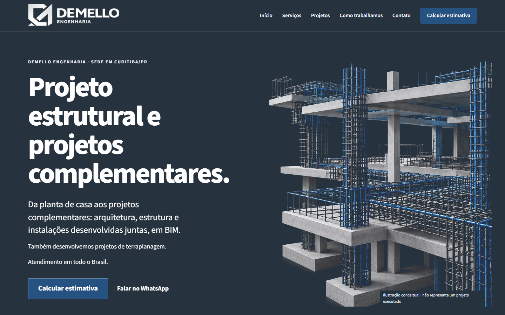
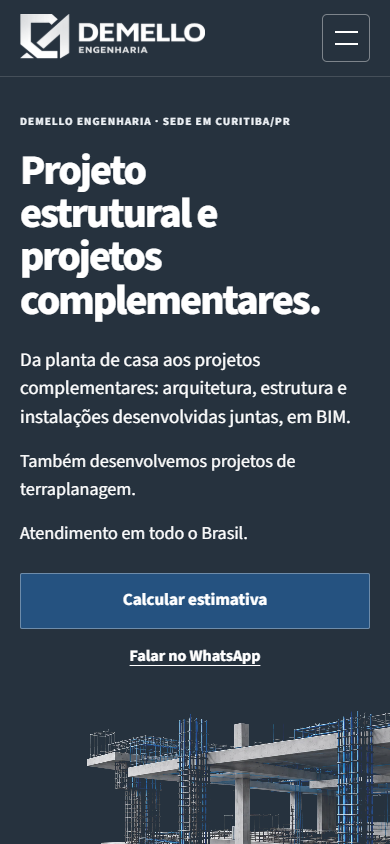

# [DIAG] — Auditoria visual da home arquivada

**Escopo:** home da branch `arquivo/home-20261028`, não a versão publicada. Revisão em 28/10/2026, após autorização específica para navegador local. Nenhum redesign ou alteração no site executado.

**Parecer:** a home tem uma direção visual aproveitável. O problema principal é a hierarquia e a distribuição do conteúdo ao longo da página: a abertura é visual, enquanto a sequência de serviços, situações e entregáveis se torna um catálogo extenso, especialmente no mobile. Há também acabamentos incompletos e inconsistentes. Essa é uma AVALIAÇÃO ESTÉTICA fundamentada nas capturas; não é uma medição de conversão.

## Fonte e verificação técnica

- Branch da home: `arquivo/home-20261028`, commit `cca24fffa6720ad5ac97a882957df7e73057657c`.
- Branch do script original: `diag/home-20261028-captura`, commit `b795ef2df7f4cc5f93eee9a4e8aa92408e088207`.
- `index.html`: SHA-256 `73b5794b623eb118555beb04c1d8b77a8f924c906dc2fa2d1f892dbfef973573`, conferido antes e depois.
- H1 renderizado: `Projeto estrutural e projetos complementares.`
- Fonte obtida por `git archive`, em diretório temporário fora dos checkouts existentes; sem checkout, reset ou stash.
- Captura do HTML original por HTTP em loopback, sem reescrever HTML/CSS/JS/imagens. Scripts locais mantidos, diferentemente do script auxiliar estático. Capturador próprio temporário em Playwright, com Chrome/Chromium 156.0.8078.48 já instalado.
- Requisições limitadas à origem local e aos métodos GET/HEAD. Service workers e WebSockets bloqueados; CSP proibiu conexões, formulários e recursos externos. Simple Analytics e Meta foram bloqueados. Seus dois avisos de CSP por carregamento são esperados nesse ambiente; não foram tratados como defeitos de produção.
- Servidor e navegador encerrados ao término.

| Verificação | Desktop | Mobile |
|---|---|---|
| Viewport, escala 1 | 1440 × 900 | 390 × 844 |
| Screenshot integral | 1440 × 9947 | 390 × 14950 |
| Largura do documento | 1440; sem overflow horizontal | 390; sem overflow horizontal |
| CSS | 2 folhas carregadas e regras acessíveis | 2 folhas carregadas e regras acessíveis |
| Fontes | Source Sans 3: 400, 600, 700, 800 carregadas | Mesmos quatro pesos carregados |
| Imagens | 15 carregadas; nenhuma quebrada | 15 carregadas; nenhuma quebrada |
| Erros JavaScript da página | Nenhum | Nenhum |
| Recursos locais com erro HTTP | Nenhum | Nenhum |
| FAQ | Abertura confirmada | Abertura confirmada |
| Menu mobile | Não se aplica | Abriu e fechou; aria-expanded acompanhou o estado |
| CTA principal | Abriu `/orcamento/?situacao=build` | Abriu a mesma rota |

O teste da tarefa principal termina na entrada da estimativa, com título “O que você vai fazer?”. Não foram preenchidos formulários, calculados valores, enviados dados ou acionados WhatsApp/telefone/e-mail. Não é validação completa do funil comercial.

## Capturas verificadas

[Desktop integral](capturas/desktop-full.png) · [Mobile integral](capturas/mobile-full.png) · [Verificação e hashes](capturas/verificacao.json)

As imagens integrais foram abertas e examinadas. Todos os 11 blocos de cada viewport, a faixa informativa e o rodapé também foram examinados em recortes legíveis. Os recortes finais são pixels extraídos das capturas integrais; não foram retocados. Capturas iniciais de seções que incluíam sobreposição do cabeçalho sticky durante a operação da ferramenta foram rejeitadas e substituídas por esses recortes. Essa sobreposição não foi atribuída ao design da home.

### Primeira dobra

### Sequência examinada

Os números correspondem aos arquivos `desktop-section-XX.png` e `mobile-section-XX.png`, no mesmo diretório das capturas integrais.

| Etapa | Conteúdo | Estado observado / avaliação |
|---|---|---|
| 01 | Hero e entrada | Renderização íntegra. H1 forte, marca reconhecível, CTA visível nos dois viewports. No mobile, a imagem começa no fim da primeira dobra; a seção completa, mais cabeçalho, ocupa aproximadamente 1018 px. Peso textual alto, sem corte horizontal. |
| 02 | Proprietário / arquiteto e construtora | Caminhos distinguíveis, duas colunas no desktop e empilhamento legível no mobile. Há intervalo excessivo entre os dois parágrafos do proprietário, visível nos dois tamanhos. |
| 03 | Integração BIM | Boa distinção por azul e branco; texto, CTA e imagem têm funções claras. Legenda conceitual presente. O desenho comunica integração, mas não comprova compatibilização técnica real. |
| 04 | Experiência e Djalma | Estatísticas e case oferecem um contraponto concreto às ilustrações conceituais. A imagem real do acervo e o painel branco funcionam. A apresentação é extensa no mobile: aproximadamente 1585 px. As capturas não verificam ARTs, quantitativos, autoria documental ou os 16 m de desnível. |
| 05 | Clientes | Conteúdo carregado, mas pesos ópticos desiguais: um cliente somente em texto, JHE leve, Geribello num retângulo escuro largo e Odara pequeno. A composição pede alinhamento e equilíbrio, sem alterar marcas. |
| 06 | Serviços em destaque | Estrutura, hidrossanitário e incêndio têm linguagem visual coerente. Terraplanagem exibe um painel tipográfico, sem imagem; o README confirma que a imagem ainda estava pendente. Não é falha de carregamento. Arquitetura aparece em texto e links, sem destaque visual equivalente. |
| 07 | Situações e serviços diretos | Caminhos comerciais claros, ícones consistentes e links reconhecíveis. O bloco repete visualmente a lógica de catálogo e ocupa aproximadamente 1812 px no mobile. |
| 08 | Escopo e entregas | Conteúdo legível e bem separado por disciplina. A sequência de oito grupos de texto ocupa aproximadamente 1992 px no mobile e acentua o caráter documental. |
| Faixa | Identificação, ferramentas e formatos | Informações presentes, menores e subordinadas. A leitura é possível nos recortes; não se verificou contraste pixel a pixel nem leitura em aparelho físico. |
| 09 | Funcionamento da estimativa | Sequência numerada e distinção estimativa/proposta/obra são compreensíveis; CTA aparece novamente. O bloco é longo no mobile, aproximadamente 1515 px. |
| 10 | FAQ | Separação clara e resumo clicável. A abertura do primeiro item foi confirmada; em seguida ele recebeu um segundo clique para recolher. Não se realizou auditoria completa de teclado/leitor de tela. |
| 11 | CTA final | Fechamento visual coerente com a seção BIM; botão branco se destaca. O vínculo com o caminho principal foi preservado. |
| Rodapé | Identidade e contatos | Leitura e alinhamento preservados nos dois tamanhos; contatos não acionados. Logo oficial exibida no arquivo, sem manipulação nesta auditoria. |
| Teste | Menu e entrada da estimativa | Menu mobile funcional. CTA principal alcançou a primeira pergunta da estimativa local nos dois viewports. Não prova cálculo, envio, CRM ou serviços externos. |

## Achados e separação das evidências

**FATO — extensão e concentração.** O documento tem 9947 px no desktop e 14950 px no mobile, aproximadamente 11,1 e 17,7 alturas dos respectivos viewports. No mobile, clientes, serviços em destaque e situações formam uma sequência branca contínua de cerca de 4823 px; depois vêm 1992 px de entregáveis. Comprimento, isoladamente, não é defeito nem prova de abandono.

**AVALIAÇÃO ESTÉTICA — problema central.** Depois dos blocos de imagem e prova, muitas listas, divisórias e parágrafos recebem tratamento semelhante. Falta uma diferença mais nítida entre o que deve ser visto rapidamente e o que deve ser lido como detalhe. A página mantém legibilidade, mas perde ritmo e síntese visual.

**FATO — acabamento provisório.** Terraplanagem usa um painel com a palavra “Terraplanagem”, enquanto os três serviços anteriores usam imagens. A diferença de tratamento é visível. A causa está documentada no README; não se inventou uma imagem ausente.

**AVALIAÇÃO ESTÉTICA — primeira dobra.** Grafite, branco, azul, Source Sans 3 e a estrutura 3D formam uma abertura coerente. O H1 em quatro linhas dá presença e a ação principal está disponível. Não há evidência para tratar o grafite como causa central ou trocar a paleta inteira. No mobile, convém avaliar redução de espaçamentos antes de reduzir fonte ou esconder informação.

**AVALIAÇÃO ESTÉTICA — imagens.** As imagens conceituais de concreto, armaduras e instalações compartilham materialidade e cores; não há imagem quebrada. O hero reaparece no serviço estrutural, reduzindo variedade. O case Djalma tem linguagem de modelo técnico, diferente das ilustrações, o que pode reforçar a distinção entre acervo e conceito. Não é necessário transformá-lo em render publicitário. Não se auditou correção estrutural/hidráulica das imagens.

**AVALIAÇÃO ESTÉTICA — arquitetura e escala.** O catálogo visual destaca três complementares e terraplanagem; arquitetura depende de menções e links. Isso pode deixar o peso visual da oferta desigual. Não prova ausência do serviço nem autoriza acrescentar novo bloco.

**HIPÓTESE — comportamento.** A repetição visual e o percurso extenso podem aumentar o esforço de varredura, principalmente no mobile. As imagens de estrutura e instalações também podem ser percebidas como mais próximas de obras grandes. Essas hipóteses exigem teste com usuários; não se afirma perda de conversão, rejeição do público residencial ou causa comercial comprovada.

**NÃO CONFIRMADO.** Conversão, abandono, experiência em aparelho físico, demais larguras, Safari/Firefox, zoom, leitores de tela, contraste medido, teclado completo, desempenho de produção, documentação das afirmações comerciais, integridade funcional integral do orçamento e efeitos das integrações externas.

## [PROP] — Correções sustentadas pelas capturas, sem execução

Impacto e esforço são estimativas de design, não resultados medidos. Nenhuma proposta autoriza implementação.

| Prioridade | Evidência | Proposta delimitada | Impacto estimado | Esforço |
|---|---|---|---|---|
| 1 | Painel provisório em 06 | Fechar a direção da imagem de terraplanagem, ou aprovar um tratamento tipográfico deliberado que dialogue com as outras linhas. Não gerar/substituir imagem nesta tarefa. | Alto no acabamento | Médio; depende de escolha humana |
| 2 | Sequência longa de 06–09 | Rever espaçamentos e níveis tipográficos de títulos, introduções e detalhes, principalmente no mobile; preservar textos, links, ordem e arquitetura comercial. Não compactar tudo nem reduzir a legibilidade. | Alto no ritmo | Médio |
| 3 | Intervalo entre parágrafos em 02 | Corrigir as margens acumuladas no bloco do proprietário e aproximar textos que pertencem à mesma explicação. | Médio | Baixo |
| 4 | Pesos desiguais em 05 | Alinhar áreas de exposição e ajustar escala óptica/intervalos dos clientes, preservando integralmente cada marca e a alternativa em texto. | Médio | Baixo |
| 5 | Hero mobile e blocos 03/04 | Afinar espaço entre texto, ação, figura e legenda; manter CTA acessível e imagens sem deformação. | Médio | Baixo a médio |
| 6 | Arquitetura visualmente secundária em 06 | Decidir se o destaque visual deve representar também arquitetura. Se aprovado depois, estudar uma solução localizada; não alterar agora a seleção de serviços. | Potencialmente alto; depende do posicionamento | Médio e decisão humana |

Não há evidência para trocar toda a paleta, reescrever o H1, substituir a home por produção, gerar novas imagens ou refazer integralmente o site.

## [CONSO] — Respostas objetivas

1. **Principal problema visual:** hierarquia e ritmo no percurso completo, com concentração de blocos extensos de catálogo na segunda metade, sobretudo no mobile. O painel provisório de terraplanagem é o acabamento incompleto mais evidente.
2. **Preservar:** identidade grafite/azul/branco, tipografia legível, abertura 3D, caminhos por público, seção BIM, case Djalma, distinção entre ilustração e acervo, CTAs e distinção estimativa/proposta/obra. Copy aprovada e arquitetura comercial permanecem protegidas.
3. **Melhorias justificadas:** concluir terraplanagem; corrigir margens específicas; equilibrar clientes; ajustar a hierarquia e os intervalos das sequências de texto; revisar o peso visual de arquitetura apenas após decisão humana. São propostas, não melhorias já comprovadas por teste comparativo.
4. **Redesign integral:** não há necessidade demonstrada. Intervenções localizadas são a primeira resposta proporcional. A auditoria não concede aceite à home nem transforma essa recomendação em autorização para implementar.
5. **Decisões humanas pendentes:** imagem/tratamento de terraplanagem; representação visual de arquitetura; aprovação de um eventual delta visual; aceite do resultado após implementação e validação. A Etapa 2 continua aberta.

## Revisões efetivamente realizadas

- **Plugin Management:** consulta real de catálogo/disponibilidade; sem instalação ou mudança de permissões.
- **Superpowers:** continuidade do estado íntegro, leitura canônica e preparação técnica em paralelo, verificação antes de declarar integridade/conclusão.
- **Governança:** Doc01 V02 lido integralmente pelo agente principal; Doc02 V08 e Doc03 V83 lidos integralmente por leitores delegados, em blocos sem truncamento, com revisão e integração dos resultados pelo principal. Revisão canônica `30eaff64c3fdd2b4c69ea7e3239290289bc41ee6`. Doc03 não fixa direção visual específica da home; não se transferiram decisões do portal/masterplanner para ela.
- **Product Design:** preflight executado; nenhum contexto salvo disponível. Auditoria da superfície atual, capturas abertas, sequência e riscos associados às imagens, teste da entrada principal e limites documentados.
- **UI UX Designer:** revisão da hierarquia, espaçamentos, alinhamentos, responsividade, clareza de caminhos e prioridades de correção sobre as capturas efetivamente examinadas.
- **Técnico:** integridade, CSS/fontes/imagens, console, largura, menu, FAQ e entrada da estimativa local verificados.
- **Visual:** toda a home inspecionada nos dois viewports. Nenhum defeito do site foi corrigido porque a missão é exclusivamente diagnóstica.
- **Aceite humano:** pendente. Testes técnicos e revisão de design não o substituem.

Nenhum commit, merge, PR, deploy, redesign, alteração de copy/SEO, CRM ou integração. Nenhum contato ou envio externo. O agendamento único já foi encerrado.
